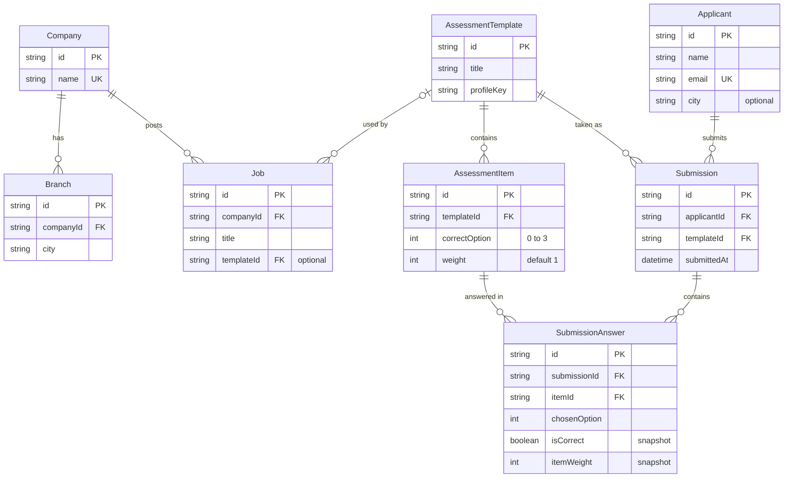

# LoadUp challenge: job-applicant selection API

This is my solution to a take-home backend challenge for LoadUp's hiring process (September 2025): an API that picks the best applicants for a job at a given branch, based on their assessment results. I built it in TypeScript with Fastify, Prisma, PostgreSQL and Zod: endpoints to create, list, get and delete companies, branches, jobs and applicants; assessment templates and submissions; two ranking endpoints; and a seed script that generates 1,000 applicants. The key design decisions: a submission snapshots each answer's correctness and weight when it's submitted, so later changes to a test don't rewrite old scores; the ranking is one parameterized SQL query with configurable negative marking, recency boost and location bonus; and ties are broken deterministically, with each score's breakdown returned next to it.

## Quick start

You need Node.js 20+ and Docker.

```bash
cp .env.example .env   # the defaults match docker-compose.yml
npm run setup          # npm install, start Postgres, run migrations, seed
npm run dev            # API on http://localhost:3000, Swagger UI at http://localhost:3000/docs
```

Rank some candidates:

```bash
curl http://localhost:3000/sample/job-branch    # a job and a branch of the same company
curl "http://localhost:3000/jobs/<jobId>/top-candidates?branchId=<branchId>"
```

| Command | What it does |
|---|---|
| `npm run setup` | `npm install`, `docker compose up -d`, waits 5 seconds, `prisma migrate dev`, seed |
| `npm run dev` | runs `src/server.ts` with tsx (no file watching) |
| `npm run db:up` / `npm run db:down` | start Postgres / stop it and delete its volume |
| `npm run migrate` | `prisma migrate dev`, which also generates the Prisma client into `src/generated/prisma` |
| `npm run seed` | deletes all rows, then generates seed data (see below) |
| `npm run seed:verify` | prints counts, distributions and integrity checks for the seeded data |
| `npm test` | request-level tests against the running server |
| `npm run build` / `npm start` | compile with tsc, copy the generated Prisma client, and run from `dist` |

### Seed data

`npm run seed` deletes all existing rows first. Volumes come from environment variables, in `.env` or inline (`SEED_APPLICANTS=5000 npm run seed`):

| Variable | Default | What it controls |
|---|---|---|
| `SEED_COMPANIES` | 4 | logistics companies (DB Schenker, DHL Logistics, Hermes Group, GLS Germany, ...). Names come from a list of six and are unique, so 6 at most. |
| `SEED_BRANCHES` | 2 | branches per company |
| `SEED_JOBS` | 2 | jobs per company, each linked to a template by profile (warehouse management, driving and logistics, logistics coordination) |
| `SEED_TEMPLATES` | 3 | assessment templates |
| `SEED_ITEMS` | 10 | questions per template. In the warehouse template, safety questions weigh 3 and management questions 2; every other question weighs 1. |
| `SEED_APPLICANTS` | 1000 | applicants. 70% live in Berlin, Munich, Hamburg, Cologne or Frankfurt, the rest in random cities. |

About 85% of applicants take an assessment and 30% of those take two. Answers are correct 65% of the time, and submissions are spread over the last 30 days.

## Architecture

One Fastify app. Each resource has its own route file, request bodies and queries are validated with Zod, and the ranking lives in one service (`src/services/matching.ts`) that runs a single SQL query through Prisma.

| Layer | Choice | Why |
|---|---|---|
| Runtime | Node.js 20+, TypeScript (ES modules), tsx in development | tsx runs the TypeScript directly, no build step while developing |
| HTTP | Fastify 5.6, `@fastify/swagger` and `@fastify/swagger-ui` | fast, good TypeScript types, Swagger UI with little setup |
| Validation | Zod 4 | runtime validation with inferred TypeScript types |
| Database | PostgreSQL 16 in Docker Compose, Prisma 6 | typed client, migrations, parameterized queries |
| Logging | Pino, through Fastify's logger | structured logs, pretty-printed in development |
| Tests | Vitest and Supertest | request-level tests over HTTP |

```
src/server.ts              Fastify setup, Swagger, correlation id, error handler, routes
src/routes/                one file per resource, plus health, matches, top-candidates, stats, sample
src/schemas/               Zod schemas for request validation
src/lib/                   HttpError, the Zod parse helper, JSON schemas for Swagger
src/services/matching.ts   the ranking query
prisma/                    schema, migration, seed
scripts/                   setup and seed verification
test/                      request-level tests
```

### Domain model



Design decisions:

- A job belongs to a company. The branch is chosen per ranking request and has to belong to the same company, otherwise the API answers 400.
- A job has at most one assessment template, and one template can be used by several jobs.
- When a submission comes in, the API checks that every answered item belongs to the template, then stores `isCorrect` and `itemWeight` on each answer. Scores are computed from those snapshots, not from the current items.
- Only an applicant's latest submission for the job's template counts.
- Scoring runs in SQL: one query with CTEs and `ROW_NUMBER()`, with no N+1 queries.
- There are indexes on every foreign key and on the applicant search fields (`name`, `email`, `city`, and `createdAt, id`).
- List endpoints take `limit` (1 to 100, default 25) and `offset`, return `{ data, paging }`, and sort newest first.

### Errors and logging

Errors have one shape:

```json
{ "error": { "code": "BAD_REQUEST", "message": "Validation failed", "fields": { "email": ["Invalid email format"] } } }
```

- Validation failures (Zod, the route JSON Schemas and malformed JSON) are 400, Zod ones with the messages per field, missing records 404, unique conflicts 409 (company name, applicant email, template `profileKey`), and anything unexpected 500 with a generic message and no stack trace.
- The correlation id comes from the `x-request-id` header when the client sends one (otherwise Fastify's request id) and is logged with every error.
- Logs are pretty-printed in development and JSON in production (`NODE_ENV=production`, level from `LOG_LEVEL`). Prisma logs its queries when `NODE_ENV=development`.

It's a challenge project: there's no authentication, CI/CD or monitoring.

## Scoring algorithm

For each applicant, take their latest submission for the job's template and its snapshotted answers:

```text
correctWeight = sum of itemWeight over correct answers
wrongWeight   = sum of itemWeight over wrong answers      (unanswered items count as neither)

raw           = correctWeight - negativeMarkingFraction * wrongWeight
recencyBoost  = raw * recencyBoostPct / 100                             if submitted within recencyWindowDays, else 0
locationBonus = locationBonusFixed + raw * locationBonusPctOfRaw / 100  if the applicant's city equals the branch's city, else 0
total         = raw + recencyBoost + locationBonus
```

Ties are broken by `total` DESC, then `raw` DESC, then the latest submission DESC, then `applicantId` ASC, so the same data and parameters always give the same order.

`POST /matches` takes every parameter per request; `/jobs/:id/top-candidates` always uses the defaults:

| Parameter | Default | Range |
|---|---|---|
| `scoring.negativeMarkingFraction` | 0.25 | 0 to 1 |
| `scoring.recencyWindowDays` | 30 | whole days, 0 or more |
| `scoring.recencyBoostPct` | 10 | 0 to 100 |
| `scoring.locationBonusFixed` | 5 | 0 to 100 |
| `scoring.locationBonusPctOfRaw` | 0 | 0 to 100 |
| `filters.cityEqualsBranch` | false | if true, only applicants in the branch's city are ranked |
| `limit` | 25 | 1 to 100 |

The service clamps the values again before building the query. Applicants with no submission for the template aren't ranked, and a template with no submissions at all returns an empty list.

An example with the defaults: an applicant in Hamburg submitted 12 days ago, answered items worth 12 correctly and items worth 4 wrongly, and is ranked for a Hamburg branch.

```text
raw           = 12 - 0.25 * 4   = 11
recencyBoost  = 11 * 10 / 100   = 1.1
locationBonus = 5 + 11 * 0 / 100 = 5
total         = 11 + 1.1 + 5    = 17.1
```

Each ranked entry carries its breakdown:

```json
[
  {
    "applicantId": "<applicantId>",
    "total": 17.1,
    "raw": 11,
    "negativePenalty": 1,
    "recencyBoost": 1.1,
    "locationBonus": 5,
    "lastSubmissionAt": "2025-09-17T08:21:05.000Z",
    "explanation": {
      "correctWeight": 12,
      "wrongWeight": 4,
      "negativeMarkingFraction": 0.25,
      "recencyApplied": true,
      "recencyWindowDays": 30,
      "recencyBoostPct": 10,
      "locationMatched": true,
      "locationBonusFixed": 5,
      "locationBonusPctOfRaw": 0
    }
  }
]
```

## API

Swagger UI runs at `/docs`. The companies, branches and matches routes have JSON Schemas for it; they're written by hand next to the Zod schemas (`src/lib/zodToJsonSchema.ts`, `src/routes/matches.ts`), not generated from them. The other routes show up without parameter schemas.

| Method | Path | Notes |
|---|---|---|
| `GET` | `/health` | `{ "ok": true }` |
| `POST` | `/companies` | `name`; 409 if the name exists |
| `GET` | `/companies` | `search` (name contains, case-insensitive), `limit`, `offset` |
| `GET`, `DELETE` | `/companies/:id` | 404 if it doesn't exist |
| `POST` | `/branches` | `companyId`, `city`; 400 if the company doesn't exist |
| `GET` | `/branches` | `companyId`, `city` (contains, case-insensitive), `limit`, `offset` |
| `GET`, `DELETE` | `/branches/:id` | 404 if it doesn't exist |
| `POST` | `/jobs` | `companyId`, `title`, optional `templateId`; 400 if the company or template doesn't exist |
| `GET` | `/jobs` | `companyId`, `title` (contains, case-insensitive), `limit`, `offset` |
| `GET`, `DELETE` | `/jobs/:id` | 404 if it doesn't exist |
| `POST` | `/applicants` | `name`, `email`, optional `city`; 409 if the email exists |
| `GET` | `/applicants` | `q` (name, email or city contains), `city` (exact, case-insensitive), `limit`, `offset` |
| `GET`, `DELETE` | `/applicants/:id` | 404 if it doesn't exist |
| `POST` | `/assessment-templates` | `title`, `profileKey` (409 if taken), `items` with `text`, `correctOption` (0 to 3) and `weight` (1 to 10, default 1) |
| `GET` | `/assessment-templates/:id` | the template with its items |
| `POST` | `/submissions` | `applicantId`, `templateId`, optional `submittedAt`, `answers` with `itemId` and `chosenOption`; 400 if the applicant or template doesn't exist or an item isn't part of the template. Returns the submission and a `summary` with `answered`, `correctWeight` and `wrongWeight`. |
| `POST` | `/matches` | ranked candidates, body below |
| `GET` | `/jobs/:id/top-candidates` | `branchId` (required), `limit` (default 5). Same ranking with the default parameters. |
| `GET` | `/stats` | row counts for all eight tables |
| `GET` | `/sample/job-branch` | a job and a branch of the same company, for trying the ranking |

```bash
curl -X POST http://localhost:3000/matches \
  -H "Content-Type: application/json" \
  -d '{
    "jobId": "<jobId>",
    "branchId": "<branchId>",
    "limit": 5,
    "filters": { "cityEqualsBranch": false },
    "scoring": {
      "negativeMarkingFraction": 0.25,
      "recencyWindowDays": 30,
      "recencyBoostPct": 10,
      "locationBonusFixed": 5,
      "locationBonusPctOfRaw": 0
    }
  }'
```

Both ranking endpoints answer 404 if the job or branch doesn't exist, and 400 if they belong to different companies or the job has no template.

## Testing

The tests are request-level: Vitest and Supertest against the running server on `http://localhost:3000`. Postgres has to be up and seeded, and `npm run dev` running.

| File | What it checks |
|---|---|
| `test/health.stats.test.ts` | `GET /health` returns `{ ok: true }`; `GET /stats` returns counts |
| `test/errors.validation.test.ts` | a duplicate company name gives 409; an unknown company gives 404 with an error code; a job and branch from different companies give 400 or 404 |
| `test/matches.happy.test.ts` | `POST /matches` returns a ranked array whose entries have `applicantId`, `total`, `raw`, `lastSubmissionAt` and an `explanation` |

```bash
npm run dev                 # terminal 1
npm test                    # terminal 2, all tests
npm test -- matches.happy   # one file
```

The matches test fails until the first known issue below is fixed.

## Trade-offs and what I'd do next

Trade-offs and limits:

- Jobs belong to companies and the branch is a request parameter, instead of a separate JobOpening entity.
- No authentication or authorization. The focus was the matching logic.
- OFFSET pagination: simple, but slower for deep pages. The `(createdAt, id)` index on applicants is already there for keyset pagination.
- Scores are computed per request instead of precomputed, so the parameters can change on every call, at the cost of re-aggregating each time. `/jobs/:id/top-candidates` is a thin wrapper around the same service with fixed defaults, which makes it the natural place for a short-TTL cache (Redis, for example) when hiring managers keep opening the same top five.
- The location match is exact, case-sensitive equality on the city name.
- `raw` can go negative with many wrong answers and a high `negativeMarkingFraction`. The percentage boosts scale with `raw`, so for a negative score they push it further down.

What I'd do next:

- Generate the Swagger schemas from the Zod schemas (Zod 4 has `z.toJSONSchema`) so validation and docs can't drift apart.
- Build the app in a function so tests can use `app.inject` against a throwaway database, and test the scoring math, tie-breaking and parameter defaults directly.
- Update endpoints (there are none yet), JWT-based auth with roles, and API versioning.
- Keyset pagination, caching for top candidates, read replicas and background jobs for bulk operations, once the volume calls for it.

## AI assistance

I used AI assistance (GitHub Copilot) during this challenge to speed up development. It helped me with:

- structuring the project setup (Fastify, Prisma, Docker)
- drafting boilerplate for routes, validation and seed scripts
- iterating on the SQL scoring logic
- debugging test failures and Postgres syntax issues
- polishing the documentation

All final design decisions, the domain model and the implementation were reviewed, tested and integrated by me.

In November 2026 I used Claude to restructure this README and to fix the response-schema, error-handling, branch-schema and build issues I found while reviewing the code.

## License

MIT, see [LICENSE](LICENSE).
