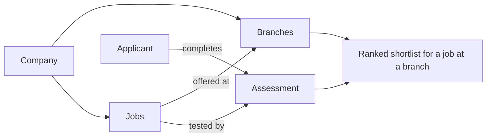

# How the product works

This guide is for teammates who don't read code: operations, recruiting, sales, or anyone who wants to know what the system does and why.

## In one sentence

A logistics company posts a job at one or more of its locations, applicants take a short assessment, and the system gives the recruiter a ranked shortlist with the reasons behind each score.

## The pieces

| Thing | What it means | Example |
|---|---|---|
| **Company** | A logistics business using the platform | DB Schenker |
| **Branch** | One physical location of a company | DB Schenker Munich |
| **Job** | A role the company is hiring for, offered at one or more of its branches | Warehouse Manager, in Berlin and Munich |
| **Applicant** | A person looking for work | Alex, based in Hamburg |
| **Assessment** | A set of questions for a job profile. Important questions can count more. | Warehouse skills test, where safety questions count three times |
| **Submission** | One applicant's completed assessment | Alex's answers from 12 days ago |

## From job to shortlist

1. The company and its branches are added.
2. A job is created and assigned to the branches where it's available.
3. The job is linked to the assessment that fits the role.
4. Applicants register and complete the assessment. Their answers are marked right or wrong at that moment.
5. A recruiter picks a job and a branch and asks for the best candidates.
6. The system returns the ranked list and shows how each score was built.

## How a score is built

Every score has up to four parts:

| Part | Effect | Why it exists |
|---|---|---|
| **Correct answers** | Add points, weighted by how important the question is | Skills are the main signal |
| **Wrong answers** | Subtract a quarter of the question's points | Discourages guessing |
| **Recent assessment** | Adds 10% if taken in the last 30 days | Favors applicants who are currently active |
| **Same city** | Adds 5 points if the applicant lives in the branch's city | Favors applicants who already live near the job |

These are the default settings. Each search can change them, or turn wrong-answer penalties and the recency bonus off, with no code change.

**Example.** Alex lives in Hamburg and is ranked for a Hamburg branch. Alex took the test 12 days ago, earned 12 points on correct answers, and missed questions worth 4 points.

| Step | Points |
|---|---|
| Correct answers | +12 |
| Wrong answers (a quarter of 4) | −1 |
| Recent assessment (10% of 11) | +1.1 |
| Same city | +5 |
| **Total** | **17.1** |

If two applicants have the same total, the same tie-break rules always apply, so a search never reshuffles by chance.

## Rules worth knowing

- **Two applicants can share an email address.** People sometimes do, for example within a family, so an email doesn't identify a person.
- **A job can only be ranked at a branch that offers it.** A Berlin-only job can't produce a Munich shortlist.
- **Each question counts once.** A submission that answers the same question twice is rejected, so nobody can inflate a score.
- **Old results don't change.** If a test is edited later, past submissions keep the score they earned, so a hiring decision can always be explained.
- **Records in use can't be deleted by accident.** A company with branches, a branch offering a job, or an applicant with assessment results is kept, and the system explains what's in the way.
- **Mistakes get a clear message.** A blank company name, for example, is rejected with a note about which field to fix.

## What it doesn't do yet

- There are no user accounts or permissions, so anyone with access to the API can change data.
- Because emails can be shared, the system can't tell when one person registers twice.
- City matching is exact, so "Munich" and "München" count as different cities.
- Existing records can't be edited yet. Changing a job's branches means deleting and recreating the job.
